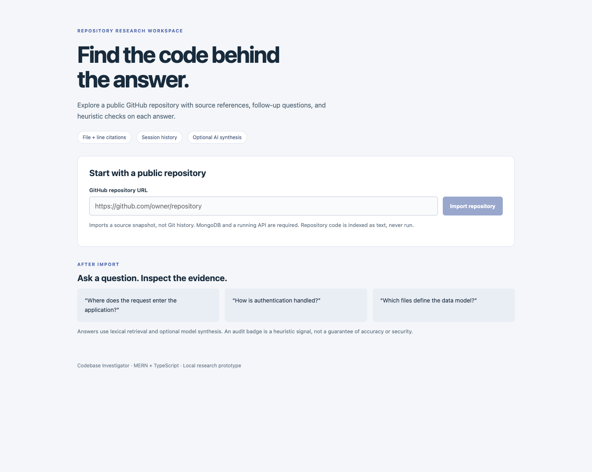
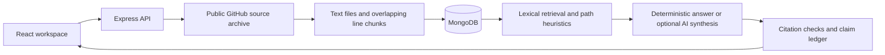

# Codebase Investigator

Trace a code question back to files and line ranges in a public GitHub repository. This MERN and TypeScript prototype combines repository indexing, lexical retrieval, optional model synthesis, and heuristic checks on the resulting answer.

The interesting part is the evidence loop: a session keeps cited answers and a claim ledger flags possible changes in stance across turns. The checks help a reviewer decide what to inspect next. They do not establish that an answer is correct, that code is unused, or that a repository is secure.



## From URL to evidence



Imports use the default-branch archive, not a clone or historical commit search. Text files become 60-line chunks with an 8-line overlap. Retrieval ranks token overlap and file-path signals, with special handling for architecture, authentication, and dead-code questions. It is not vector search: the stored embedding field is currently empty.

Without provider credentials, the app uses deterministic narratives. With configuration, it tries Bedrock first, then OpenAI, then falls back. Source snippets and questions can therefore leave your machine when a provider is enabled. Never import sensitive material into a shared deployment. Live environment files and `.npmrc` are excluded from indexing; `.env.example` remains useful source documentation. This exclusion is not a general secret detector.

## Run locally

Requirements: Node.js 20 or later, npm, and a reachable MongoDB instance. Use a local development database, not a production database.

```sh
cp .env.example .env
npm ci --ignore-scripts
npm run dev
```

Set `MONGODB_URI` in the root `.env` if MongoDB is not at `mongodb://127.0.0.1:27017/codebase-investigator`. Leave provider credentials unset for deterministic mode. The API listens on http://localhost:4000 and Vite on http://localhost:5173. The client API base is configured through `client/.env.example`.

Paste a public `https://github.com/owner/repo` URL. After indexing completes, ask a concrete question such as “Where does an API request enter the application?” or “Which files define the data model?” Inspect the citations alongside the answer. Failed imports and failed questions display an error; a failed question stays in the editor for retry.

## API walkthrough

Create an index:

```http
POST /api/repos/import
Content-Type: application/json

{"githubUrl":"https://github.com/owner/repo"}
```

Successful responses contain `repoId`, `fileCount`, and `chunkCount`. Then create a session with `POST /api/chat/sessions` and `{"repoId":"<returned id>"}`. Ask through `POST /api/chat/<sessionId>/ask` with `{"question":"How does authentication work?"}`.

An answer returns `turnId`, `answer`, `citations`, `audit`, and optional `changedStance`. Each citation carries a chunk ID, path, start line, and end line. Read prior turns with `GET /api/chat/<sessionId>/history`. `GET /health` is a liveness check; it does not confirm database readiness.

## What the checks mean

The auditor checks citation existence and paths, simple text overlap, evidence selection, overconfident wording, and deletion advice. Its score subtracts a fixed amount per issue. A “pass” is a heuristic result, not an independently measured probability. The claim ledger uses topic and polarity heuristics; apparent contradictions need human review. Neither component performs whole-program analysis or proves semantic grounding.

The retrieval implementation currently loads the repository's chunks into memory for each question. Large repositories need bounded ingestion, a retrieval index, pagination, job processing, and resource controls before this design scales. Archive download and extraction limits are not yet enforced. The API has no authentication, rate limits, or per-user data isolation. Run it as a local prototype rather than exposing it as a public ingestion service.

## Build and verify

```sh
npm test
npm run typecheck --workspace client
npm run build
node server/dist/index.js
```

The build produces `server/dist` and `client/dist`; the server serves the latter in production. The committed root `public/` directory is an older build artifact, not the active source of this interface. Rebuild from `client/src` for deployment.

Tests cover the existing answer gate, auditor, and claim ledger, plus failed API responses and exclusion of live environment files and external symlinks. They use fixtures/mocks, not a live provider. The screenshot shows the actual empty import workspace; it is not a fabricated successful investigation.

`render.yaml` is a deployment starting point. A deployment needs its own MongoDB and environment configuration; the presence of that file is not evidence of a running hosted demo. Provider calls, a full MongoDB-backed import, and hosted deployment were not exercised in this review.
