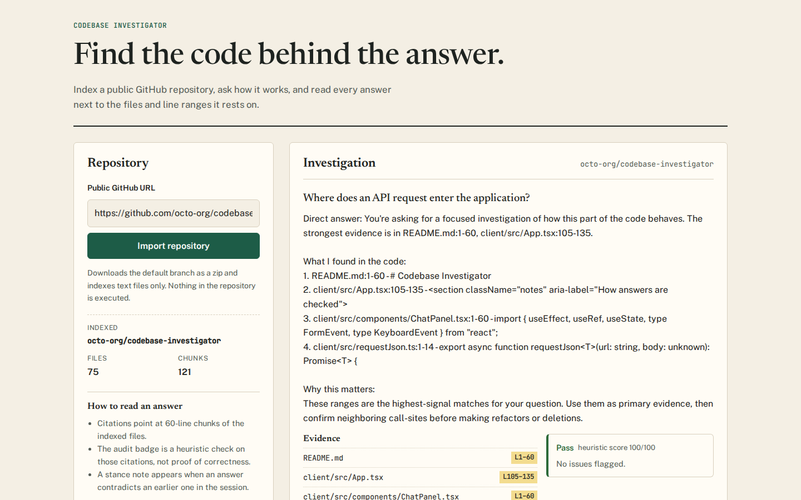
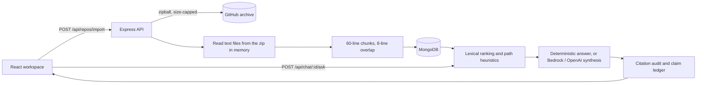
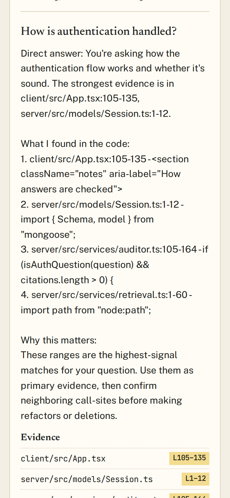

# Codebase Investigator

Trace a code question back to files and line ranges in a public GitHub repository. Paste a repository URL, ask how something works, and every answer comes back with the chunks it rests on and a heuristic audit of those citations.

The interesting part is the evidence loop. A session keeps every cited answer, an auditor checks that the citations exist and fit the question, and a claim ledger flags when a later answer contradicts an earlier one. These checks help a reviewer decide what to read next. They do not establish that an answer is correct, that code is unused, or that a repository is secure.



## From URL to evidence



- **Import** downloads the default branch as a zip (not a clone, no history) and reads it in memory. Nothing is extracted to disk and nothing in the repository runs.
- **Retrieval** is lexical: word overlap plus path signals, with extra handling for overview, authentication, service and dead-code questions. Tests count half unless the question is about tests. There is no vector search; the stored `embedding` field is empty.
- **Answers** are deterministic narratives by default. With credentials, the server tries AWS Bedrock first, then OpenAI, and falls back to the deterministic text if both fail or time out (45 s). When a provider is enabled, questions and source snippets leave your machine.
- **Structure questions** ("list the top-level folders and entry files") are answered from the indexed file list instead of ranked chunks.

## Run it

### With Docker Compose

Requires Docker with Compose v2.

```sh
docker compose up --build
```

Open http://localhost:4000. Compose starts MongoDB 8.2 and the app (built by the two-stage `Dockerfile`, run as the `node` user, published on `127.0.0.1` only). No provider keys are needed. To enable synthesis, export `OPENAI_API_KEY` or the four `AWS_*` variables before starting.

Run lint and the test suite against the same MongoDB:

```sh
docker compose run --rm test
docker compose --profile test down -v   # stop everything and drop the database volume
```

### Without Docker

Requires Node.js 22 (see `.nvmrc`) and a MongoDB you can reach. Use a local development database, not a production one.

```sh
cp .env.example .env
npm ci --ignore-scripts
npm run dev
```

The API listens on http://localhost:4000 and the Vite dev server on http://localhost:5173. `client/.env.example` shows how to point the UI at another API origin.

For a production-style run, `npm run build` compiles `server/dist` and bundles `client/dist`, and `node server/dist/index.js` serves both from port 4000.

### Using it

1. Paste a public `https://github.com/owner/repo` URL and choose **Import repository**. The ledger shows how many files and chunks were indexed.
2. Pick a suggested question or write your own, for example "Where does an API request enter the application?" or "Which files define the data model?". Ctrl or Cmd + Enter sends.
3. Read the answer next to its **Evidence** list (path and line range for each chunk) and the **Audit** card.



## Configuration

All settings are environment variables; `.env.example` lists them with comments.

| Variable | Default | Purpose |
| --- | --- | --- |
| `PORT` | `4000` | HTTP port |
| `MONGODB_URI` | `mongodb://127.0.0.1:27017/codebase-investigator` | Database |
| `CORS_ORIGINS` | `http://localhost:5173` | Comma-separated browser origins allowed to call the API. Not needed when the server serves the UI itself |
| `IMPORT_MAX_ARCHIVE_MB` | `50` | Largest zipball accepted |
| `GITHUB_API_URL` | `https://api.github.com` | Archive host, for GitHub Enterprise or an offline stand-in |
| `OPENAI_API_KEY`, `OPENAI_MODEL`, `OPENAI_TEMPERATURE` | unset, `gpt-4o`, `0.1` | Optional OpenAI synthesis |
| `AWS_ACCESS_KEY_ID`, `AWS_SECRET_ACCESS_KEY`, `AWS_REGION`, `AWS_BEDROCK_MODEL_ID` | unset | Optional Bedrock synthesis; all four are required |
| `MONGODB_TEST_URI` | `mongodb://127.0.0.1:27017/codebase-investigator-test` | Tests only |

## API

The examples below were captured from the Compose stack. The repository was this project's own source, served as `octo-org/codebase-investigator` by a local stand-in for GitHub's archive endpoint (`GITHUB_API_URL`), so no request left the machine. Long answers are shortened with `…`.

Import a repository:

```http
POST /api/repos/import
Content-Type: application/json

{"githubUrl": "https://github.com/octo-org/codebase-investigator"}
```

```json
201 Created
{"repoId": "6af1870ee641eaff47e70804", "fileCount": 75, "chunkCount": 121}
```

Open a session for a ready repository, then ask:

```http
POST /api/chat/sessions
{"repoId": "6af1870ee641eaff47e70804"}
```

```json
201 Created
{"sessionId": "6af187de7fa6e6d090a58826"}
```

```http
POST /api/chat/6af187de7fa6e6d090a58826/ask
{"question": "Where is the archive size limit enforced?"}
```

```json
201 Created
{
  "turnId": "6af187de7fa6e6d090a58827",
  "answer": "Direct answer: You're asking for a focused investigation of how this part of the code behaves. The strongest evidence is in server/tests/retrieval.test.ts:1-46, server/src/services/archive.ts:53-102.\n\nWhat I found in the code:\n…",
  "citations": [
    {"chunkId": "6af187de7fa6e6d090a587bd", "filePath": "server/tests/retrieval.test.ts", "startLine": 1, "endLine": 46},
    {"chunkId": "6af187de7fa6e6d090a587e3", "filePath": "server/src/services/archive.ts", "startLine": 53, "endLine": 102},
    {"chunkId": "6af187de7fa6e6d090a587f5", "filePath": "server/src/services/download.ts", "startLine": 1, "endLine": 60},
    {"chunkId": "6af187de7fa6e6d090a587fa", "filePath": "server/src/services/ingestion.ts", "startLine": 1, "endLine": 60}
  ],
  "audit": {"verdict": "pass", "trustScore": 100, "issues": [], "checks": {"citationIntegrity": true, "quoteOverlap": true}}
}
```

That answer shows the method's limits as well as its use: the top hit is a test that repeats the question's words, ahead of the three files that actually enforce the limit. An answer can also carry `changedStance` when the claim ledger sees a contradiction. `GET /api/chat/:sessionId/history` returns the stored turns, and `GET /api/repos/:repoId` returns the repository record and its import status. `GET /health` is a liveness check only; it does not wait for MongoDB.

Errors are JSON with a `message`:

| Case | Status | Message |
| --- | --- | --- |
| URL is not a plain `github.com/owner/repo` | 400 | `Invalid GitHub URL. Expected https://github.com/owner/repo` |
| Repository missing or private | 404 | `Repository not found, or it is not public.` |
| Question under 5 characters | 400 | `Invalid request. question: Too small: expected string to have >=5 characters` |
| Archive over the size or file limits | 413 | names the limit |
| Same repository already importing / too many imports | 409 / 429 | |
| Session for an unknown or failed import | 404 / 409 | |
| MongoDB unreachable | 503 | `Database unavailable. …` |

## What the checks mean

The auditor checks that each citation exists and matches its path, that the answer overlaps the cited text, that behaviour questions are not backed mostly by docs or config, that auth, service and dead-code questions cite plausible files, and that deletion advice mentions call-sites. Its score subtracts 25 per issue. A "Pass" is a heuristic result, not a measured probability. The claim ledger compares topic keys and polarity across turns; an apparent contradiction needs a human to read both answers. Neither component analyses the whole program or proves an answer is grounded.

## Import limits and safety

Imported repositories are untrusted input, so the importer:

- accepts only `https://github.com/<owner>/<repo>` with GitHub's name characters, so `..`, query strings or extra path segments never reach the archive URL;
- streams the download with a 60 s timeout and stops at `IMPORT_MAX_ARCHIVE_MB`;
- reads entries straight from the zip buffer, skipping traversal names, symlinks, binaries, non-UTF-8 text, vendored or build folders, and files over 512 KB; it refuses archives with more than 5000 indexable files or 64 MB of text;
- never indexes live `.env*` files or `.npmrc` (`.env.example` is kept as documentation). This is not a general secret scanner;
- runs at most two imports per server process, one per repository.

The API has no authentication, per-user isolation or request rate limiting, and retrieval loads a repository's chunks into memory for each question. Treat it as a local research tool rather than a public ingestion service.

## Development

```sh
npm run lint                         # ESLint over server, client and scripts
npm test                             # Vitest; needs MongoDB (MONGODB_TEST_URI or the local default)
npm run typecheck --workspace client
npm run build
```

The suite (78 tests) covers URL parsing, archive reading (traversal, symlinks, limits), the bounded download, the HTTP API end to end with a fixture archive server, database reconnects, SPA fallback, question classification, retrieval ranking, the auditor, the claim ledger and provider fallback. Providers are mocked and GitHub is never called.

```
server/src/
  routes/       repos.ts (import, status), chat.ts (sessions, ask, history)
  services/     download, archive, ingestion, retrieval, answerer,
                structureAnswer, auditor, claimLedger, synthesisPrompt,
                aiSynthesizer (OpenAI), bedrockSynthesizer
  utils/        github URL parsing, file filter, question intent, path roles
client/src/     App (import ledger), components/ChatPanel, CitationList, AuditBadge
scripts/        productionBuild.mjs (tsc for the server, Vite for the client)
```

## Deploying to Render

`render.yaml` describes one Node web service that runs `scripts/productionBuild.mjs` and starts `node server/dist/index.js` with `/health` as its health check. Set `MONGODB_URI` in the Render dashboard; the file only declares it. The file is a starting point. It does not mean a hosted demo exists, and a hosted deployment has not been exercised.

## License

MIT, see [LICENSE](LICENSE).
